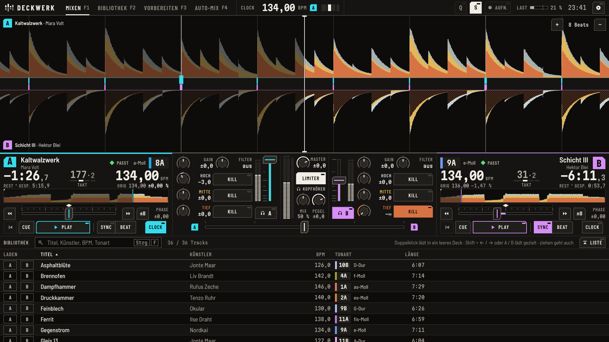
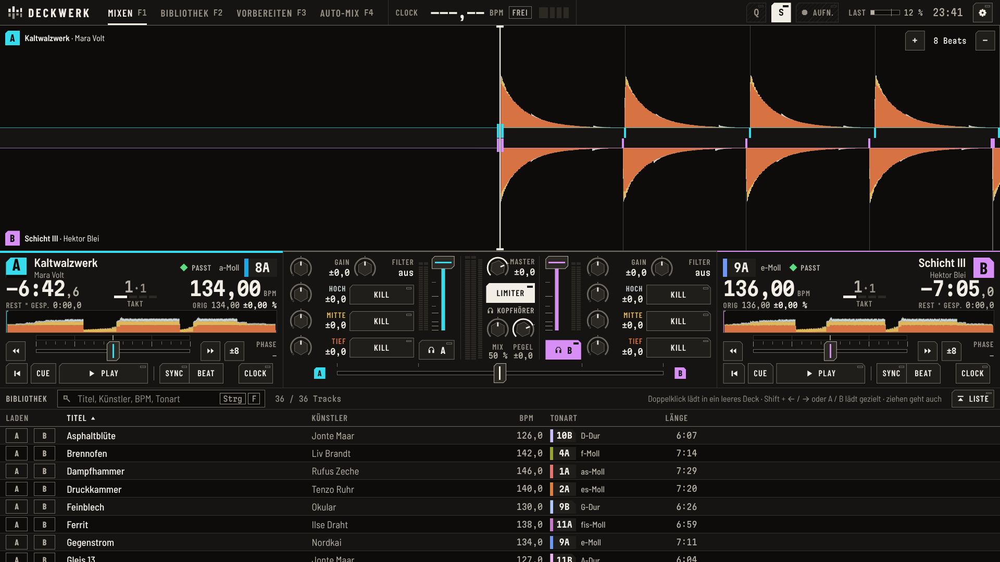
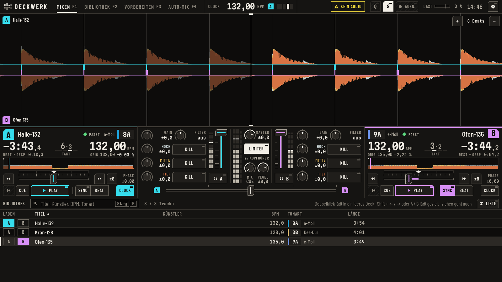
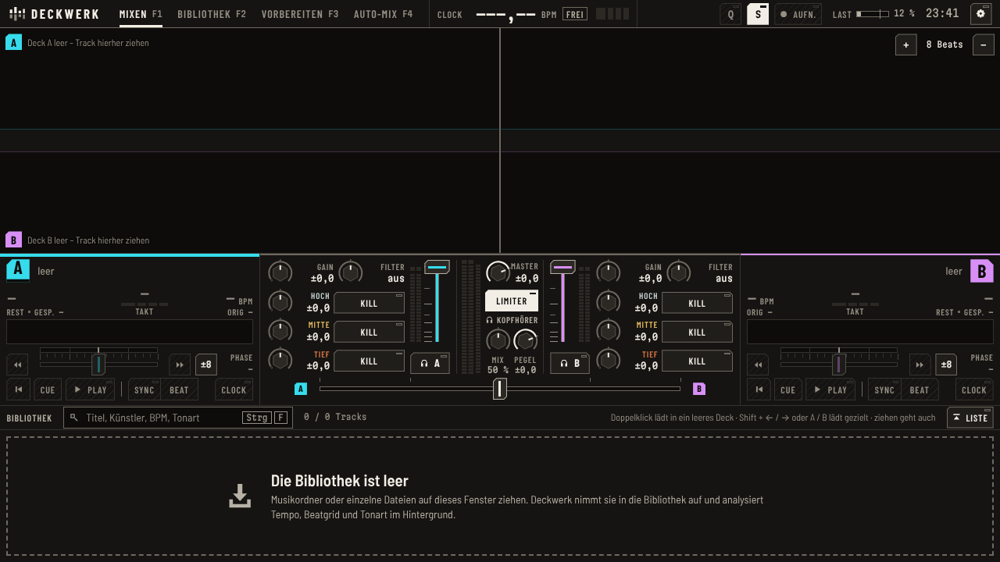
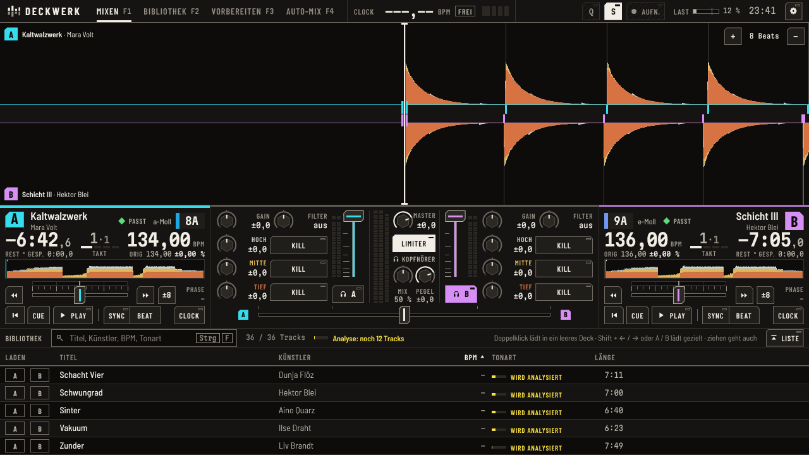
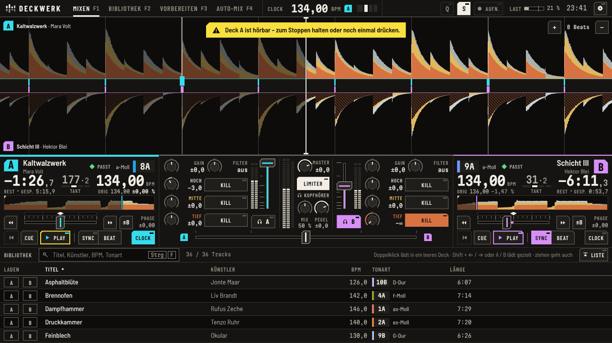

# Deckwerk

Deckwerk ist eine Desktop-DJ-Software für Techno. Sie analysiert Tracks (Tempo, Beatgrid, Tonart, Lautheit), mixt sie live an virtuellen Decks und kann Übergänge selbst planen und als Audiodatei rendern. Der Kern ist in Rust geschrieben, die Oberfläche läuft in einer nativen Hülle (Tauri) unter Windows, macOS und Linux.



Der Name ist ein Arbeitstitel.

## Stand

Das Projekt ist im Aufbau. Fertig sind das Fundament und der größte Teil des Kern-Mixings (Stufe 0 und 1 von 8 im [Umsetzungsplan](docs/spezifikation.md#11-umsetzungsplan)).

| Bereich | Stand |
|---|---|
| Dateien lesen: MP3, WAV, AIFF, FLAC, AAC, ALAC, OGG Vorbis, Opus | fertig, getestet |
| Analyse: Tempo, Beatgrid, Downbeat, Tonart, Lautheit, Wellenform | fertig; bisher nur an synthetischen Tracks gemessen |
| Engine: vier Decks, Sync, Mixer mit EQ, Filter, Crossfader, Limiter, Kopfhörer-Weg | fertig, getestet |
| Bibliothek: Import, Suche, Playlists, Sicherung | Kern fertig; in der Oberfläche bisher Liste, Suche und Laden |
| Oberfläche: Ansicht „Mixen" mit zwei Decks | fertig, von zwei unabhängigen Prüfern begutachtet, Befunde eingearbeitet |
| Desktop-Anwendung: Oberfläche am echten Kern | läuft unter Linux; Import, Analyse, Laden und synchrone Wiedergabe dort gezeigt |
| Automatischer Übergang: langer Blend mit Bass-Tausch | fertig für zwei Tracks, über die Kommandozeile |
| Ton-Ausgabe am Audiogerät | geschrieben, aber noch an keinem Gerät geprüft |
| Windows und macOS | Kern-Tests und Installer laufen in der Build-Pipeline durch; gestartet wurde die Anwendung dort noch nicht |
| Key Lock, Loops, Hotcues, Effekte, Auto-Mix für ganze Sets, Stems, Remix-Decks, Import aus Traktor/Rekordbox | noch nicht begonnen (Stufen 2–8) |

Den genauen Stand mit Messwerten, offenen Punkten und dem nächsten Schritt führt [docs/fortschritt.md](docs/fortschritt.md).

## Bilder

| | |
|---|---|
|  Zwei Tracks mit unterschiedlichem Tempo. Die Wellenformen wachsen von einer gemeinsamen Beat-Schiene weg; der Versatz der Beats ist auf der Schiene gelb markiert. |  Die Desktop-Anwendung mit echtem Kern unter Linux: drei importierte und analysierte Tracks, zwei davon laufen synchron. Ein Audiogerät gab es auf der Testmaschine nicht, daher der Hinweis „Kein Audio". |
|  Nach dem ersten Start: Musik wird auf das Fenster gezogen. |  Importierte Tracks werden im Hintergrund analysiert. |
|  Ein hörbares Deck stoppt erst beim zweiten Griff. | |

Bis auf das Bild der echten Anwendung stammen die Bilder aus der Oberfläche mit simuliertem Kern; die Tracknamen darin sind erfunden. Sie entstehen automatisch (`pnpm shots` in `ui/`) und werden mit `ui/scripts/doku-bilder.sh` in die Dokumentation übernommen.

## Schnellstart

Voraussetzungen: Rust (stabil, ab 1.80), Node 22 mit pnpm 10, ein C-Compiler und CMake. Unter Linux zusätzlich:

```bash
sudo apt-get install -y libwebkit2gtk-4.1-dev librsvg2-dev libasound2-dev
```

Fertige Installer für Linux, Windows und macOS hängen als Artefakte an jedem Lauf der Build-Pipeline (GitHub, Reiter „Actions"). Selbst bauen und starten:

```bash
pnpm --dir ui install
```

```bash
pnpm --dir ui build
```

```bash
cargo run --release -p deckwerk-app
```

Musikordner oder einzelne Dateien auf das Fenster ziehen. Die Analyse läuft im Hintergrund. Die Bedienung beschreibt das [Handbuch](docs/handbuch.md).

Ohne Oberfläche, über die Kommandozeile:

```bash
cargo run --release -p dw-cli -- analyze track1.mp3 track2.flac
```

```bash
cargo run --release -p dw-cli -- mix track1.mp3 track2.flac -o mix.wav --bars 32
```

Wer keine passenden Tracks zur Hand hat, erzeugt Testmaterial mit bekanntem Tempo und bekannter Tonart:

```bash
cargo run --release -p dw-cli -- testtrack a.wav --bpm 132 --key 8A
```

Alle Tests:

```bash
cargo test --workspace
```

```bash
pnpm --dir ui test
```

## Aufbau

```
crates/
  dw-core       Grundtypen: Tonart, Beatgrid, Befehle, Zustands-Schnappschuss
  dw-dsp        EQ, Filter, Limiter, Interpolation, Abtastratenwandlung
  dw-decode     Audiodateien lesen, WAV schreiben
  dw-analysis   Tempo, Beatgrid, Tonart, Lautheit, Wellenform
  dw-engine     Decks, Master-Clock, Sync, Mixer, Offline-Render
  dw-audio      Echtzeit-Anbindung und Ausgabe am Audiogerät
  dw-library    Bibliothek (SQLite): Import, Suche, Playlists, Sicherung
  dw-automix    automatische Übergänge
  dw-testgen    synthetische Referenz-Tracks für die Tests
  dw-cli        Kommandozeile „deckwerk"
app/            Desktop-Hülle (Tauri 2)
ui/             Oberfläche (TypeScript, React, WebGL 2)
docs/           Spezifikation, Handbuch, Fortschritt, Designsystem
```

Der Ton entsteht vollständig im Rust-Kern in einem eigenen Echtzeit-Thread. Die Oberfläche zeigt nur an und sendet Befehle; ruckelt sie, bleibt der Ton unberührt.

## Dokumentation

| Dokument | Inhalt |
|---|---|
| [Handbuch](docs/handbuch.md) | Bedienung: Musik importieren, mixen, Tastenbelegung, Kommandozeile |
| [Spezifikation](docs/spezifikation.md) | Anforderungen, Verfahren, Architektur, Umsetzungsplan |
| [Fortschritt](docs/fortschritt.md) | was fertig ist, was gemessen wurde, was offen ist, nächster Schritt |
| [Designsystem](docs/designsystem.md) | Leitidee, Farben, Schriften, Komponenten |
| [Schnittstelle Oberfläche–Kern](docs/kern-schnittstelle.md) | Befehle und Datenformate zwischen `ui/` und `app/` |
| [Prompts](docs/prompts/) | die beiden Aufträge, aus denen Spezifikation und Bau hervorgegangen sind |

## Lizenz

Noch nicht festgelegt (offene Frage F2 in der Spezifikation). Die verwendeten Bausteine stehen unter MIT, Apache-2.0, BSD oder MPL-2.0; Bausteine unter GPL werden nicht verwendet.
