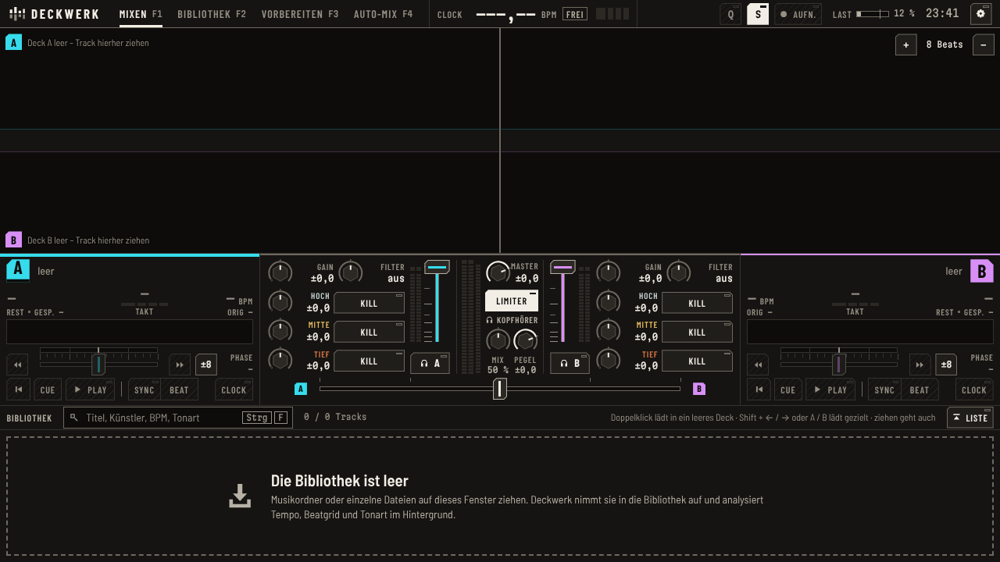
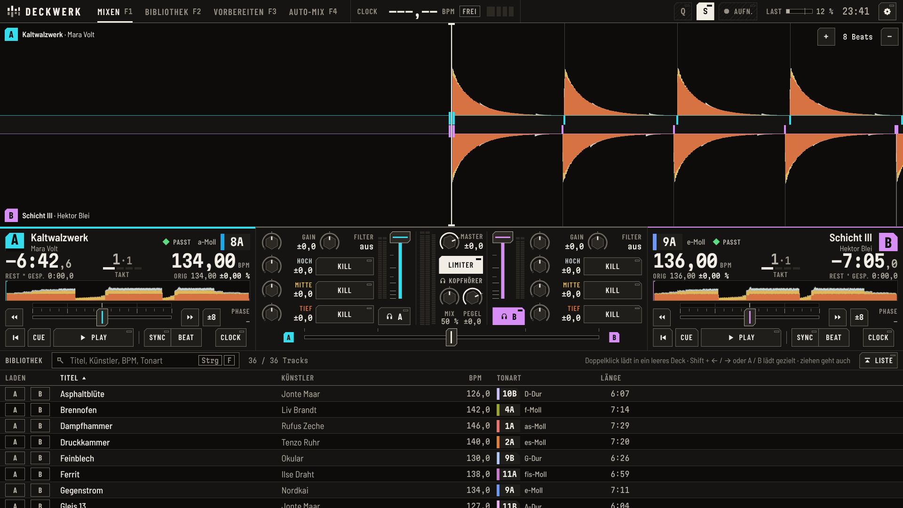
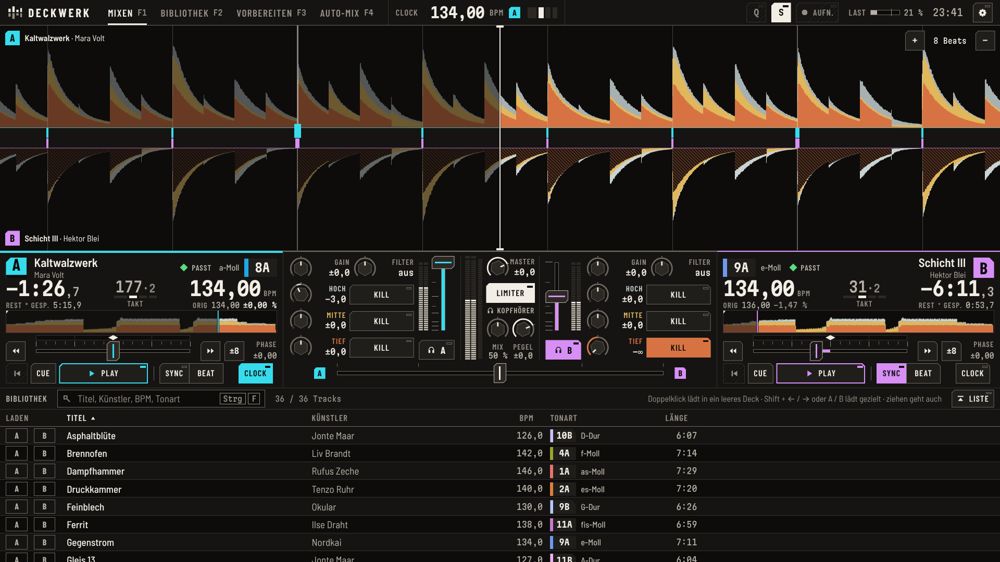
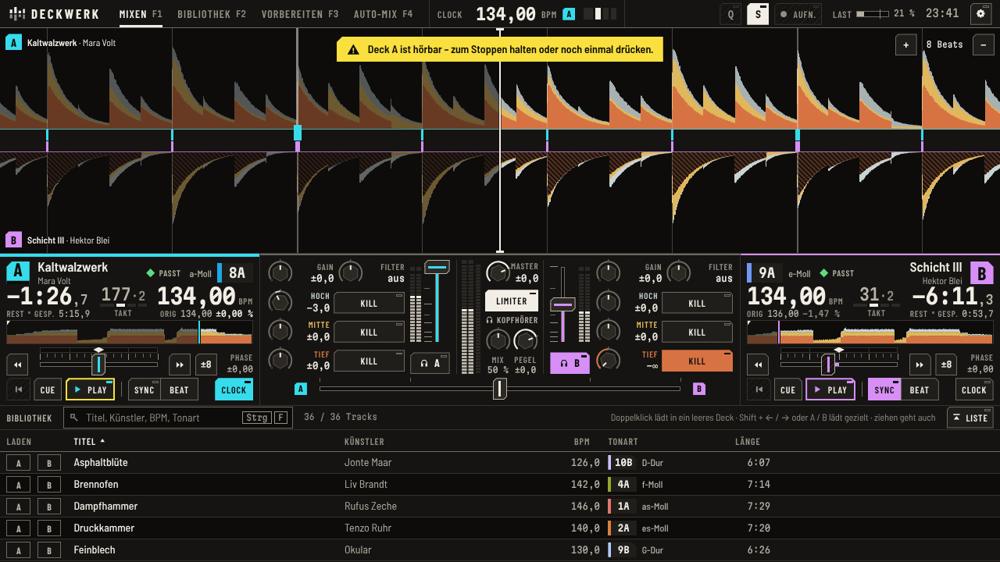

# Handbuch

Stand: Stufe 1. Beschrieben ist nur, was gebaut ist. Was noch fehlt, steht am Ende.

## Starten

Bauen und Starten beschreibt die [README](../README.md#schnellstart). Beim ersten Start ist die Bibliothek leer.



Das Ausgabegerät wählst du in den Einstellungen (Zahnrad oben rechts) unter „Audio-Ausgabe": „Systemstandard" oder eines der aufgeführten Geräte. Der Wechsel wirkt sofort, geladene Decks laufen weiter, und die Wahl bleibt über einen Neustart erhalten. Lässt sich ein Gerät nicht öffnen, steht der Grund unter der Liste und das bisherige Gerät läuft weiter.

Findet die Anwendung kein Audiogerät, erscheint in der Kopfzeile ein Warnhinweis. Die Engine läuft dann stumm weiter: Alles lässt sich bedienen, es ist nur nichts zu hören.

## Musik importieren

Ordner oder einzelne Dateien auf das Fenster ziehen. Ordner werden mit allen Unterordnern durchsucht.

- **Formate:** MP3, WAV, AIFF, FLAC, AAC/M4A, ALAC, OGG Vorbis, Opus.
- **Sofort sichtbar:** Die Tracks erscheinen gleich in der Liste, zunächst mit den Angaben aus der Datei.
- **Analyse im Hintergrund:** Tempo, Beatgrid, Tonart, Lautheit und Wellenform werden nacheinander berechnet. Die Kopfzeile der Bibliothek zeigt, wie viele Tracks noch warten. Ein Track von sieben Minuten braucht ein bis zwei Sekunden.
- **Doppelte Dateien:** Was schon in der Bibliothek ist, wird nicht noch einmal angelegt, auch nicht unter anderem Namen.
- **Verschobene Dateien:** Wird ein Track verschoben oder umbenannt und der neue Ort importiert, behält er seine Analyse.


Die Musikdateien selbst werden nur gelesen, nie verändert.

## Die Ansicht „Mixen"



Von oben nach unten:

| Bereich | Inhalt |
|---|---|
| Kopfzeile | Ansichten, Tempo der Master-Clock mit Taktgeber, Hinweis „Kein Audio", Snap (S), DSP-Last, Uhr, Einstellungen |
| Bühne | Wellenformen beider Decks an einer gemeinsamen Beat-Schiene, Abspielmarke in der Mitte |
| Decks A und B | Titel, Tonart, BPM, Takt, Restzeit, Übersichts-Wellenform, Phase, Tempo, Transport |
| Mixer | je Kanal Gain, EQ mit Kill, Filter, Kopfhörer-Cue, Pegel, Fader; in der Mitte Master und Kopfhörer; unten der Crossfader |
| Bibliothek | Suche und Trackliste; die Taste „Liste" zieht sie auf und schrumpft die Decks auf eine Zeile |

### Wellenformen lesen

- **Drei Schichten:** Kupfer zeigt die Tiefen (Kick, Bass), Messing die Mitten, das helle Zinn die Höhen.
- **Spiegelung:** Deck A wächst von der Schiene nach oben, Deck B nach unten. Liegen die Beats beider Decks übereinander, stehen sich die Kicks genau gegenüber.
- **Schiene:** Marken für Beats, betonte Marken für Takte und für jeden achten Takt.
- **Schraffur:** Ein herausgenommenes Band (Kill) ist schraffiert statt gefüllt. So ist zu sehen, welches Deck gerade den Bass spielt.
- **Versatz:** Laufen zwei Decks auseinander, füllt sich die Lücke zwischen ihren Marken auf der Schiene gelb.
- **Bedienung:** Ziehen in der Wellenform schiebt das Deck an oder bremst es, das Mausrad ändert den Ausschnitt.

**Vorausblick:** Mit `Shift` + Mausrad, den Doppelpfeilen unten rechts in der Bühne oder `PgDn` / `PgUp` (vier Takte, mit `Shift` ein Takt) schiebst du die Ansicht beider Decks gemeinsam nach vorn oder zurück. Die Wiedergabe läuft dabei unverändert weiter. So siehst du, was in einer Minute zusammen erklingt, etwa ob der Einsatz des zweiten Tracks auf einen Wechsel im ersten fällt. Solange die Ansicht verschoben ist, steht in der Bildmitte eine gestrichelte gelbe Linie statt der Abspielmarke, und unten rechts zeigt die Taste „Zurück" den Abstand in Beats und Minuten. Ein Druck darauf, `Pos1` oder `Esc` bringt die Ansicht zurück zur Abspielstelle. Ein stehendes Deck verschiebt sich mit, als liefe es ab jetzt.

### Regler bedienen

| Handgriff | Wirkung |
|---|---|
| Ziehen | Wert ändern |
| Mausrad | Wert in Schritten ändern |
| Shift beim Ziehen | Feineinstellung |
| Doppelklick | Standardwert (nicht bei Kanalfader und Master-Lautstärke) |
| Klick auf die Zahl | Wert eintippen; Enter übernimmt, Esc verwirft (Gain, EQ, Filter, Tempo, Master) |

Wer mit der Maus über einem Bedienelement bleibt, sieht Name, aktuellen Wert und Tastenkürzel.

## Ein Übergang Schritt für Schritt



1. **Ersten Track laden und starten.** In der Liste auswählen, mit `Shift + ←` auf Deck A laden, `Q` startet. Das Deck wird Taktgeber; seine Taste „Clock" leuchtet, und sein Schild steht in der Kopfzeile neben dem Tempo.
2. **Zweiten Track laden.** `Shift + →` lädt auf Deck B. Die Tonart-Marke zeigt, ob er zum laufenden Track passt (passt / geht / reibt).
3. **Vorhören.** `Y` legt Deck B auf den Kopfhörer. Der Regler „Mix" im Kopfhörer-Teil blendet zwischen Vorhör-Signal und Master.
4. **Angleichen.** `O` schaltet Sync für Deck B ein: Tempo und Phase folgen dem Master. Die Phasenanzeige steht dann in der Mitte, die Kicks in der Bühne stehen sich gegenüber.
5. **Bass herausnehmen.** `H` nimmt bei B die Tiefen heraus (Kill).
6. **Einsteigen.** Deck B am Phrasenwechsel von A mit `U` starten, den Kanalfader hochziehen.
7. **Bässe tauschen.** Am nächsten Phrasenwechsel `G` (Tiefen bei A heraus) und `H` (Tiefen bei B hinein).
8. **Ausblenden.** Kanalfader von A herunterziehen oder den Crossfader zu B schieben.

Deck B übernimmt die Rolle des Taktgebers von selbst, sobald A nicht mehr zu hören ist. Tempo und Phase bleiben dabei unverändert.

## Schutz vor Fehlgriffen

Was ein hörbares Deck unterbrechen würde, braucht einen bewussten zweiten Griff. Hörbar heißt: Kanalfader offen und Crossfader dem Kanal nicht ganz abgewandt.

| Aktion am hörbaren Deck | So geht es trotzdem |
|---|---|
| Stoppen (Play) | Taste halten oder ein zweites Mal drücken |
| Cue | Taste halten oder ein zweites Mal drücken |
| Sprung in der Übersichts-Wellenform | mit Shift klicken |
| Neuen Track laden | erst stoppen |



Ein laufendes Deck springt außerdem nur bei eingeschaltetem Snap, damit es im Takt bleibt. Ein Deck, das nicht zu hören ist, lässt sich ohne Hürde bedienen. Der Schutz ist in den Einstellungen abschaltbar. Ein Doppelklick in der Liste lädt nur in ein leeres Deck; in ein geladenes Deck lädt die Lade-Taste der Zeile, `Shift + Pfeil` oder das Ablegen auf dem Deck.

## Tastenbelegung

Die Tasten sind an ihre Position auf der Tastatur gebunden, nicht an den aufgedruckten Buchstaben. Die Namen unten gelten für das US-Layout; auf einer deutschen Tastatur liegt zum Beispiel `Y` dort, wo `Z` aufgedruckt ist.

| Funktion | Deck A | Deck B |
|---|---|---|
| Play/Pause | Q | U |
| Cue | W | I |
| Sync | E | O |
| Abbremsen / Anschieben | A / S | J / K |
| Tempo − / + (fein mit Shift) | D / F | L / ; |
| Kopfhörer-Cue | T | Y |
| Tiefen-Kill | G | H |
| Filter zu / auf | Strg + A / S | Strg + J / K |
| Kanalfader auf / zu | Alt + D / F | Alt + L / ; |
| Track aus der Liste laden | Shift + ← | Shift + → |

| Funktion | Taste |
|---|---|
| Crossfader links / rechts | ← / → |
| Crossfader ganz links / rechts | Alt + ← / → |
| Liste hoch / runter | ↑ / ↓ |
| Suche | Strg + F (macOS: Cmd + F) |
| Play/Pause des zuletzt bedienten Decks | Leertaste |
| Ansichten | F1–F4 |
| Snap | F10 |
| Fokus eines Reglers lösen | Esc |

## Kommandozeile

Das Programm `deckwerk` nutzt denselben Kern wie die Anwendung, ohne Oberfläche.

**Analysieren**

```bash
deckwerk analyze track1.mp3 track2.flac
```

```
track1.mp3
  Tempo 132.00 BPM · Tonart 8A (a-Moll) · Lautheit -14.5 LUFS · Spitze -1.0 dBTP · Länge 3:53 · 1.4 s Rechenzeit
```

Mit `--json` kommt das vollständige Ergebnis samt Beatgrid als JSON.

**Übergang rendern**

```bash
deckwerk mix track1.mp3 track2.flac -o mix.wav --bars 32
```

```
A: 132.00 BPM, 8A (a-Moll)
B: 134.50 BPM, 9A (e-Moll)
Tonarten: 8A → 9A: passt (K = 0.9)
Übergang: Blend mit Bass-Tausch über 32 Takte, Tausch nach 16 Takten; A ab 130.9 s, Übergang ab 160.0 s, B ab 0.0 s
Tempo: 132.00 → 134.50 BPM (1.9 %), angeglichen über 32 Takte. Ohne Key Lock ändert sich dabei die Tonhöhe.
Gerendert: 115.3 s in 2.0 s · Übergang von 29.1 s bis 86.7 s, Bass-Tausch bei 58.0 s · größter Beat-Versatz 0.0000 Beats · Limiter bis -0.2 dB
```

| Option | Bedeutung | Standard |
|---|---|---|
| `--bars` | Länge des Übergangs in Takten: 16, 32 oder 64 | 32 |
| `--lead` | Takte von A vor dem Übergang | 16 |
| `--tail` | Takte von B nach dem Übergang | 16 |

Der Ausstieg aus A liegt auf der letzten 8-Takt-Grenze, nach der der Übergang noch Platz hat; B steigt an seinem ersten Downbeat ein. Bis 6 % Tempo-Abstand (8 % ab 32 Takten) wird das Tempo angeglichen, darüber lehnt das Programm den Blend ab.

**Testmaterial erzeugen**

```bash
deckwerk testtrack a.wav --bpm 132 --key 8A --seed 1
```

Erzeugt einen synthetischen Techno-Track mit Intro, Hauptteil, Breakdown, Drop und Outro, dessen Tempo und Tonart exakt bekannt sind.

## Wo die Daten liegen

| Inhalt | Ort |
|---|---|
| Bibliothek | Benutzerdaten-Ordner des Systems, Unterordner `library/` |
| Sicherungen der Bibliothek | `library/backups/`, die letzten zehn, bei jedem Start eine neue |
| Wellenformen | Unterordner `cache/wave/` |

Mit der Umgebungsvariable `DECKWERK_DATA` lässt sich ein anderer Ordner wählen. Ist die Bibliothek beschädigt, spielt die Anwendung beim Start die neueste Sicherung ein.

## Was noch fehlt

- **Ton am Gerät ist ungeprüft.** Die Ausgabe ist geschrieben, lief aber noch an keinem Audio-Interface. Das Gerät ist in den Einstellungen wählbar; Kanäle und Puffergröße lassen sich noch nicht einstellen. Ab vier Kanälen liegt der Kopfhörer auf Kanal 3/4.
- **Analyse an echter Musik ist ungemessen.** Die Trefferquoten stammen von synthetischen Tracks.
- **Import nur durch Ablegen** auf das Fenster; einen Ordner-Dialog gibt es noch nicht. Unter Linux ist das Ablegen selbst noch nicht von Hand geprüft.
- **Nur zwei Decks in der Oberfläche**, obwohl der Kern vier kann.
- **Kein Key Lock:** Wer das Tempo ändert, ändert die Tonhöhe mit.
- **Noch nicht gebaut:** Loops, Hotcues, Beatjump, Effekte, Aufnahme, Playlists in der Oberfläche, die Ansichten „Bibliothek", „Vorbereiten" und „Auto-Mix", Stems, Remix-Decks, Import aus Traktor und Rekordbox.

Die Reihenfolge, in der das kommt, steht im [Umsetzungsplan](spezifikation.md#11-umsetzungsplan).
